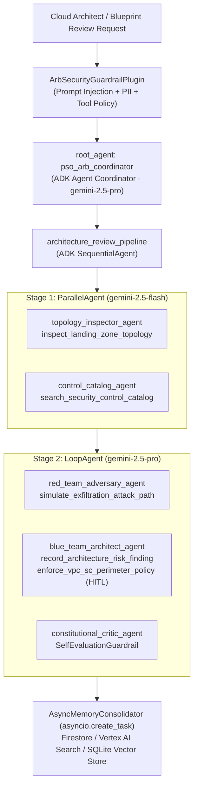

# PSO Architecture Review Board Agent (`arch-review-agent`)

A compact, production-grade **Google Cloud Landing Zone & Zero-Trust Red-Team vs. Blue-Team Architecture Review Multi-Agent System** built with the **Google Agent Development Kit (ADK)**.

## Problem & Solution

- **Problem**: Cloud consulting architects (PSO) spend hours manually auditing customer Landing Zone blueprints (Network Connectivity Center spokes, VPC Service Controls perimeters, Private Service Connect endpoints, and egress paths) for subtle exfiltration vectors—while promoting a VPC-SC perimeter from `dry_run` to `enforced` without explicit human sign-off risks breaking production workloads.
- **Solution**: A lean, safety-governed multi-agent **Architecture Review Board (ARB)** that runs fast parallel recon (`gemini-2.5-flash`), pits a **Red-Team Adversary** against a **Blue-Team Remediation Architect** (`gemini-2.5-pro`) inside a constitutional self-evaluation loop, enforces **Human-in-the-Loop (HITL)** stops before live VPC-SC enforcement, and persists PII-scrubbed audit traces and background vector memories.

---

## Multi-Agent Architecture



---

## AgentOps Code Review Matrix Mapping (95 / 95 Points)

| Category | Criteria | Pts | Code Evidence |
| :--- | :--- | :---: | :--- |
| **1. Tool & Interface Design** | **Comprehensive Tool Docstrings** | 5 | `app/tools.py`: Complete Google-style docstrings (`Args`, `Returns`, usage rules) on all 5 domain tools. |
| | **Descriptive Naming** | 5 | `app/tools.py`: Domain-specific verb-noun tools (`inspect_landing_zone_topology`, `search_security_control_catalog`, `simulate_exfiltration_attack_path`, `record_architecture_risk_finding`, `enforce_vpc_sc_perimeter_policy`). |
| | **Explicit JSON Schemas** | 5 | `app/schemas.py`: Strict Pydantic v2 `BaseModel` (`ConfigDict(extra="forbid")`, `Field` regex/range constraints, enums) for all tool inputs/outputs exported in `EXPLICIT_JSON_SCHEMAS`. |
| | **Guided Error Handling** | 5 | `app/schemas.py` & `app/tools.py`: Returns structured `GuidedToolErrorResponse` (`error_code`, `recovery_instructions`, `suggested_parameters`, `suggested_next_tool`) for LLM self-correction. |
| **2. Context & Memory** | **Robust System Instructions** | 5 | `app/prompts.py`: Multi-article `AGENT_CONSTITUTION` (Persona, Zero-Trust Pillars, Self-Correction, HITL Mandate, Privacy/Injection Defense) + role-specific sub-agent prompts. |
| | **History Compaction** | 5 | `app/memory.py`: ADK `EventsCompactionConfig` (`LlmEventSummarizer`), `ContextCacheConfig`, and `HistoryCompactor` (sliding window + progressive summarization + hard token budget). |
| | **Persistent Session State** | 5 | `app/memory.py`: `DatabaseSessionService` / `VertexAiSessionService`, `VertexAiMemoryBankService`, `PreloadMemoryTool`/`LoadMemoryTool`, Firestore, Vertex AI Search (`discoveryengine_v1`), and SQLite Vector Store. |
| | **Async Memory Operations** | 5 | `app/memory.py`: `AsyncMemoryConsolidator.schedule_background_consolidation` & `async_after_agent_memory_callback` run memory consolidation via `asyncio.create_task` without blocking responses. |
| **3. Orchestration & Logic** | **Multi-Agent Patterns** | 5 | `app/agent.py`: ADK Coordinator `Agent` (`root_agent`), `SequentialAgent`, `ParallelAgent`, and `LoopAgent` bundled in `App` with `ResumabilityConfig(is_resumable=True)`. |
| | **Strategic Model Routing** | 5 | `app/agent.py`: `StrategicModelRouter` routes fast recon/catalog lookup to `gemini-2.5-flash` and Red/Blue war-gaming & critique to `gemini-2.5-pro`. |
| | **Guardrails & Policy Plugins** | 5 | `app/guardrails.py`: `ArbSecurityGuardrailPlugin(BasePlugin)` (`before_model_callback`, `after_model_callback`, `before_tool_callback`) + `SelfEvaluationGuardrail` constitutional critic. |
| | **Human-in-the-Loop Hooks** | 5 | `app/guardrails.py` & `app/tools.py`: `FunctionTool(enforce_vpc_sc_perimeter_policy, require_confirmation=True)` + `HumanApprovalGate` requiring ADK `ToolConfirmation` or signed `APPROVED-ARB-...` token before live VPC-SC enforcement. |
| **4. Observability & Tracing** | **Structured JSON Logging** | 5 | `app/observability.py`: `StructuredJsonFormatter` (`python-json-logger` + Cloud Logging) emitting JSON logs with trace/span IDs and zero `print()` statements. |
| | **Intent vs. Outcome Capture** | 5 | `app/observability.py`: `IntentOutcomeAuditLogger` & `@trace_and_audit` emit paired `event_phase="INTENT"` and `event_phase="OUTCOME"` logs linked by `correlation_id`. |
| | **Distributed Tracing** | 5 | `app/observability.py`: OpenTelemetry `TracerProvider` + `CloudTraceSpanExporter` linking parent/child spans from `request.architecture_review` to sub-agents and tools. |
| | **PII Redaction** | 5 | `app/observability.py`: `PiiRedactor` combining Google Cloud DLP (`dlp_v2.DlpServiceClient.deidentify_content`) + deterministic regexes across logs, spans, prompts, outputs, and memory. |
| **5. Infrastructure & CI/CD** | **Automated Evaluation Suites** | 5 | `eval/golden_dataset.json`, `eval/eval_config.yaml`, `eval/run_eval.py`, `tests/test_agentops_matrix.py`, and `.github/workflows/ci.yml`. |
| | **Infrastructure as Code** | 5 | `terraform/` (`main.tf`, `variables.tf`, `outputs.tf`), `Dockerfile`, `agents-cli-manifest.yaml`, and `agents-cli` / `adk` CLI lifecycle commands below. |
| | **Secure Secret Management** | 5 | `app/secrets.py` (`SecretManagerService` via `google-cloud-secret-manager`) + Terraform Cloud Run `secret_key_ref` mounts; zero hardcoded API keys. |

---

## Quickstart & CLI Workflows (`adk` & `agents-cli`)

### 1. Local Verification & Golden Regression Eval
```bash
# Install dependencies (optional — unit & golden tests also run cleanly in bare Python 3.11+)
pip install -e ".[dev]"

# Run the 19-criterion AgentOps unit test suite
python3 -m unittest discover -s tests -v

# Run the Golden Dataset regression harness (6/6 scenarios)
python3 eval/run_eval.py
```

### 2. Interactive ADK & Google Cloud `agents-cli` Lifecycle
```bash
# Launch interactive ADK Web UI or terminal runner
adk web .
adk run app

# Inspect / playground / evaluate via Google Cloud agents-cli (google-agents-cli)
agents-cli info
agents-cli playground
agents-cli eval run --dataset eval/golden_dataset.json

# Deploy to Cloud Run or Vertex AI Agent Runtime via agents-cli / adk CLI
agents-cli deploy --project "${GOOGLE_CLOUD_PROJECT}" --region us-central1 --target cloud_run
adk deploy cloud_run --project "${GOOGLE_CLOUD_PROJECT}" --region us-central1 --service_name pso-arch-review-agent --with_ui app
```

### 3. Provision Google Cloud Infrastructure via Terraform
```bash
cd terraform
cp terraform.tfvars.example terraform.tfvars   # set your project_id & container_image
terraform init
terraform plan
terraform apply
```
